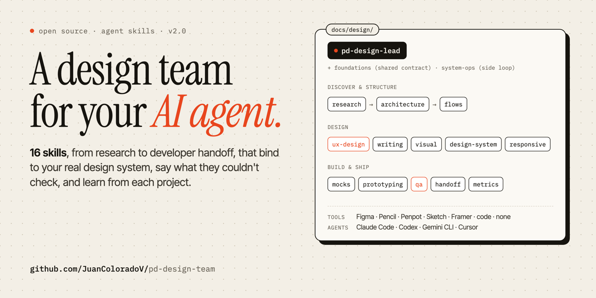
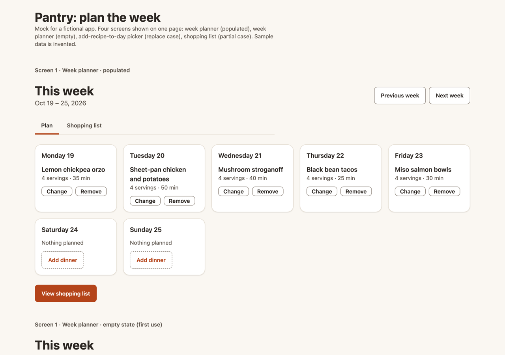

# pd-design-team



**[English](#english) · [Español](#español)**

<a id="english"></a>

**A product-design team for AI agents** — 16 skills that work like a real design org: a lead who scopes
and routes, specialists for research, information architecture, flows, screens, copy, visual design,
design systems, mocks, prototypes, responsive, QA, handoff, and metrics, and one shared contract that
makes their work interlock.

It follows the open [Agent Skills](https://agentskills.io) format, so the same files run on Claude Code,
Codex, Gemini CLI / Antigravity, Cursor, and any runtime that loads `SKILL.md` folders. It works with
whatever your designers use — Figma, Pencil, Penpot, Sketch, Framer, a design system in code, or nothing
but screenshots — and adapts to the tools and model capabilities each session actually has.

## What it is, in one minute

You talk to an AI coding agent — Claude Code, Codex, Gemini CLI / Antigravity, or Cursor's agent — in
plain language: *"Use pd-design-lead to redesign our checkout."* The skills turn that agent into a design
team. It asks what it needs, proposes a plan, and waits for your OK. Then it produces real work:

- **Design documents** in your repo (`docs/design/`): research synthesis, sitemap and navigation, flows,
  screen specs with every state, copy, visual specs, QA reports, developer handoff.
- **Screens in your design tool** when the agent has a connection to it (Figma and Pencil today; Penpot,
  Sketch, and Framer when an MCP server for them is connected), or **coded mocks** built from your real
  components and tokens.

You only run the parts you need. A copy fix goes to one specialist; a new feature might use six.

```
you ──▶ pd-design-lead ──▶ picks the smallest set of specialists for the job
                              research · architecture · flows · design · writing · visual
                              design-system · mocks · prototyping · responsive · qa · handoff · metrics
```

### What you need

- An agent that loads Agent Skills: Claude Code, Codex, Gemini CLI / Antigravity, or Cursor.
- Optional: a connection (MCP server) to your design tool, tracker, or analytics. Without one, the team
  works from files, screenshots, and exports, and tells you which checks it couldn't run.

## See it work

[`examples/pantry-meal-planner`](examples/pantry-meal-planner/) is a complete effort produced by
running the team with an AI agent on a fictional recipe app: the plan, research framed honestly as
assumptions (no invented data), flows, screen specs with every state, copy, visual and component
mapping, a coded hi-fi mock built only from design tokens, a QA report with real findings, the
developer handoff, and the retro's learnings.



## Why it's different

- **Binds to your real design system.** Specialists use your live type roles, tokens, and component
  variants and never invent names. When something is missing they log a gap, use the closest real part,
  and the system-ops loop decides whether to add it.
- **Works through files, not chat.** Every specialist reads declared input artifacts and writes one
  output artifact with a standard header in `docs/design/`. Any model can pick up where another left off.
- **Honest by construction.** Research separates findings from assumptions and needs dated sources for
  market claims. QA reports the checks it performed ("no failures found in the checks performed on 6 screens:
  automated scan, keyboard, contrast; screen readers not tested") instead of claiming conformance. Nobody reports an audit it couldn't run.
- **Evaluates and adapts.** Each effort starts with a session check (which tools are connected, whether
  the model has vision, subagents, web search) and plans around reality with open fallbacks. Each effort
  ends with a retro that writes project lessons to `LEARNINGS.md`, which every specialist reads next time.
- **Accessibility is the floor.** WCAG 2.2 AA by default, applied in every discipline rather than bolted on
  at the end; usability heuristics in every QA pass.
- **Domain packs.** Regulated domains plug in through packs (a healthcare pack ships; a template is
  included). Regulatory checks run only when the project declares them.
- **Built to be tested against models.** A 51-scenario behavioral eval suite lets you check whether a
  new model actually follows the contract; results go in `evals/results/`.

## Install

```bash
git clone https://github.com/JuanColoradoV/pd-design-team.git
cd pd-design-team
scripts/install.sh            # symlinks into every runtime it finds on this machine
```

`install.sh` targets `~/.claude/skills`, `~/.codex/skills`, `~/.agents/skills` (shared by Gemini CLI /
Antigravity and others), and `~/.gemini/skills`. Pass runtimes explicitly (`scripts/install.sh claude
codex`), install into a project (`--dir ./.claude/skills`), copy instead of link (`--copy`), or remove
(`--uninstall`). Symlinks mean one `git pull` updates every runtime.

**Claude Code plugin:**

```
/plugin marketplace add JuanColoradoV/pd-design-team
/plugin install pd-design-team@pd-design-team
```

**Uploaded skills** (e.g. claude.ai): `scripts/package.sh` builds one zip per skill plus an all-in-one
zip in `dist/`. Every specialist loads `pd-foundations`, so upload it (and `pd-design-lead`) together with
the specialists you want.

## Use it

Start with the lead for anything bigger than one discipline:

> Use pd-design-lead to redesign our checkout flow.

On a new project the lead first creates `docs/design/PROJECT.md` — product, users, where the design
system lives, design tool, tracker, analytics, domain packs, compliance, locale — inferring what it can
and asking only for the rest. Then it proposes the smallest pipeline that does the job and waits for your
OK.

For a single-discipline task, call the specialist directly:

> Use pd-ux-writing to rewrite the error messages on the signup form.

> Use pd-ux-qa to audit these screens for accessibility.

## The team

| Skill | Does |
|-------|------|
| [`pd-design-lead`](skills/pd-design-lead/SKILL.md) | Orchestrator: scope, session check, plan, route, index, retro |
| [`pd-foundations`](skills/pd-foundations/SKILL.md) | The shared contract every specialist loads first |
| [`pd-ux-research`](skills/pd-ux-research/SKILL.md) | Discovery, interviews, synthesis, personas, JTBD, opportunities |
| [`pd-ux-architecture`](skills/pd-ux-architecture/SKILL.md) | Content model, taxonomy, sitemap, navigation, findability |
| [`pd-ux-flows`](skills/pd-ux-flows/SKILL.md) | User flows, task flows, journey maps, state logic |
| [`pd-ux-design`](skills/pd-ux-design/SKILL.md) | Layout, interaction, screen specs, every state |
| [`pd-ux-writing`](skills/pd-ux-writing/SKILL.md) | Microcopy, errors, empty states, voice and tone, i18n |
| [`pd-visual-design`](skills/pd-visual-design/SKILL.md) | Type, color, spacing, hierarchy through tokens |
| [`pd-design-system`](skills/pd-design-system/SKILL.md) | Map a design to real system parts |
| [`pd-design-system-ops`](skills/pd-design-system-ops/SKILL.md) | Grow and guard the system: gaps, versions, deprecations |
| [`pd-mocks`](skills/pd-mocks/SKILL.md) | Build mocks in your design tool or in code, then audit them |
| [`pd-prototyping`](skills/pd-prototyping/SKILL.md) | Interactive prototypes and purposeful motion |
| [`pd-responsive`](skills/pd-responsive/SKILL.md) | Breakpoints, adaptive layout, platform conventions |
| [`pd-ux-qa`](skills/pd-ux-qa/SKILL.md) | Heuristics, accessibility, regulatory, design-vs-spec QA |
| [`pd-handoff`](skills/pd-handoff/SKILL.md) | Engineering-ready specs, token/component→code mapping |
| [`pd-metrics`](skills/pd-metrics/SKILL.md) | Success metrics, instrumentation, impact reading |

## Design tools

Tool specifics live in adapters under
[`pd-foundations/references/tools/`](skills/pd-foundations/references/tools/README.md), each with the same
sections — detect, capabilities, read the system, write, audit, export, quirks — and a fallback ladder for
when a tool isn't connected.

| Adapter | For | Status |
|---------|-----|--------|
| `figma.md` | Figma: read the system, build frames, verify bindings | Used in practice |
| `pencil.md` | Pencil `.pen` files via its MCP | Read path verified; write path from the vendor docs |
| `code.md` | Design systems in code: tokens, component libraries, Storybook | Used in practice |
| `manual.md` | No tool connected: screenshots, exports, inspect values | Used in practice |
| `diagrams.md` | Flows and architecture: Mermaid by default, whiteboards if connected | Used in practice |
| `penpot.md` | Penpot, including native design tokens | From docs; canvas writes need a Penpot MCP, else falls back to code/manual |
| `sketch.md` | Sketch libraries, symbols, color variables | From docs; canvas writes need a Sketch MCP, else falls back |
| `framer.md` | Framer components, styles, code components | From docs; canvas writes need a Framer MCP, else falls back |

Reports from people using the doc-based adapters with a live connection are very welcome.

Adding a tool is one file — copy `_template.md`.

## Layout

```
skills/
  pd-foundations/
    SKILL.md
    references/      contract: working agreement, project profile, adaptation, handoff protocol,
                     principles, accessibility, compliance, design system, integrations
      tools/         design-tool adapters
      domains/       domain packs (healthcare, _template)
    templates/       PROJECT.md, LEARNINGS.md, artifact, INDEX, SYSTEM-BACKLOG, CHANGELOG
  pd-*/SKILL.md      one folder per specialist (some with references/)
evals/               behavioral scenarios for checking a model against the contract
scripts/             validate.py · install.sh · package.sh
```

## Contributing

See [CONTRIBUTING.md](CONTRIBUTING.md), the [code of conduct](CODE_OF_CONDUCT.md), the
[security policy](SECURITY.md), and the [accessibility statement](ACCESSIBILITY.md). In short: keep skills generic (project data belongs in the
project's `PROJECT.md`), run `python3 scripts/validate.py`, and add or update an eval scenario for any
behavior you change.

## License

[MIT](LICENSE)

---

<a id="español"></a>

## Español

**Un equipo de diseño de producto para agentes de IA:** 16 skills que funcionan como un equipo de diseño
real. Hay un líder que define el alcance y reparte el trabajo, especialistas en investigación,
arquitectura de información, flujos, pantallas, textos, diseño visual, design systems, mocks,
prototipos, responsive, QA, handoff y métricas, y un contrato compartido que hace que el trabajo de todos
encaje.

Usa el formato abierto [Agent Skills](https://agentskills.io), así que los mismos archivos funcionan en
Claude Code, Codex, Gemini CLI / Antigravity, Cursor y cualquier entorno que cargue carpetas con
`SKILL.md`. Trabaja con lo que usen tus diseñadores (Figma, Pencil, Penpot, Sketch, Framer, un design
system en código, o solo capturas de pantalla) y se adapta a las herramientas y capacidades que tenga
el modelo en cada sesión.

### Qué es, en un minuto

Le hablas a un agente de IA (Claude Code, Codex, Gemini CLI / Antigravity o el agente de Cursor) en
lenguaje normal: *"Usa pd-design-lead para rediseñar nuestro checkout."* Las skills convierten ese agente
en un equipo de diseño. Pregunta lo que necesita, propone un plan y espera tu aprobación. Luego produce
trabajo real:

- **Documentos de diseño** en tu repo (`docs/design/`): síntesis de investigación, mapa del sitio y
  navegación, flujos, specs de pantallas con todos sus estados, textos, specs visuales, reportes de QA y
  handoff para desarrollo.
- **Pantallas en tu herramienta de diseño** cuando el agente tiene conexión con ella (hoy Figma y Pencil;
  Penpot, Sketch y Framer cuando hay un servidor MCP conectado), o **mocks en código** hechos con tus
  componentes y tokens reales.

Solo usas las partes que necesitas. Un cambio de texto va a un especialista; una funcionalidad nueva
puede usar seis.

### Qué necesitas

- Un agente que cargue Agent Skills: Claude Code, Codex, Gemini CLI / Antigravity o Cursor.
- Opcional: una conexión (servidor MCP) con tu herramienta de diseño, tu tracker o tu analítica. Sin ella,
  el equipo trabaja con archivos, capturas y exportaciones, y te dice qué revisiones no pudo hacer.

### Herramientas de diseño

Figma, código, Pencil y el modo sin herramienta están probados en la práctica (en Pencil, la lectura está
verificada y la escritura sale de la documentación oficial). Los adaptadores de Penpot, Sketch y Framer
salen de la documentación: dibujar directo en el canvas necesita un MCP de esa herramienta y, si no lo
hay, el equipo cae a código o a specs. Agregar una herramienta es copiar `tools/_template.md`.

### Míralo funcionando

[`examples/pantry-meal-planner`](examples/pantry-meal-planner/) es un trabajo completo hecho por el
equipo con un agente de IA, sobre una app de recetas ficticia: el plan, la investigación planteada con
honestidad como supuestos (sin datos inventados), flujos, specs de pantallas con todos sus estados,
textos, mapeo visual y de componentes, un mock de alta fidelidad en código hecho solo con tokens, un
reporte de QA con hallazgos reales, el handoff para desarrollo y las lecciones de la retro.

### Qué lo hace distinto

- **Se conecta a tu design system real.** Usa tus estilos tipográficos, tokens y variantes de componentes
  reales, y nunca inventa nombres. Si falta algo, registra el vacío, usa la pieza real más cercana y el
  equipo de sistema decide si se agrega.
- **Trabaja con archivos, no con chat.** Cada especialista lee sus artefactos de entrada y escribe uno de
  salida con un encabezado estándar en `docs/design/`. Cualquier modelo puede retomar donde otro quedó.
- **Honesto por diseño.** La investigación separa hallazgos de supuestos y exige fuentes con fecha para
  afirmaciones de mercado. QA reporta las revisiones que hizo y lo que no probó, en vez de declarar conformidad. Nadie reporta una
  auditoría que no pudo hacer.
- **Evalúa y se adapta.** Cada trabajo empieza revisando qué herramientas están conectadas y qué puede
  hacer el modelo (visión, subagentes, búsqueda web), y planea con alternativas explícitas. Cada trabajo
  termina con una retrospectiva que guarda las lecciones del proyecto en `LEARNINGS.md`, y todos los
  especialistas las leen la próxima vez.
- **La accesibilidad es el piso.** WCAG 2.2 AA por defecto, aplicada en cada disciplina y no al final, y
  heurísticas de usabilidad en cada revisión de QA.
- **Paquetes de dominio.** Los dominios regulados se conectan con paquetes (incluye uno de salud y una
  plantilla). Las revisiones regulatorias solo corren si el proyecto las declara.
- **Hecho para probarse contra modelos.** Una suite de 51 escenarios de comportamiento permite comprobar
  si un modelo nuevo de verdad sigue el contrato; los resultados van en `evals/results/`.

### Instalación

```bash
git clone https://github.com/JuanColoradoV/pd-design-team.git
cd pd-design-team
scripts/install.sh            # crea symlinks en cada entorno que encuentre en tu máquina
```

Instala en `~/.claude/skills`, `~/.codex/skills`, `~/.agents/skills` (compartido por Gemini CLI /
Antigravity y otros) y `~/.gemini/skills`. Puedes elegir entornos (`scripts/install.sh claude codex`),
instalar en un proyecto (`--dir ./.claude/skills`), copiar en vez de enlazar (`--copy`) o desinstalar
(`--uninstall`). Con symlinks, un `git pull` actualiza todos los entornos a la vez.

**Plugin de Claude Code:**

```
/plugin marketplace add JuanColoradoV/pd-design-team
/plugin install pd-design-team@pd-design-team
```

**Skills subidas** (por ejemplo en claude.ai): `scripts/package.sh` genera un zip por skill y uno con
todo en `dist/`. Todos los especialistas cargan `pd-foundations`, así que súbelo (junto con
`pd-design-lead`) con los especialistas que quieras.

### Cómo usarlo

Para cualquier cosa que toque más de una disciplina, empieza con el líder:

> Usa pd-design-lead para rediseñar nuestro flujo de checkout.

En un proyecto nuevo, el líder primero crea `docs/design/PROJECT.md` con el producto, los usuarios, dónde
vive el design system, la herramienta de diseño, el tracker, la analítica, los paquetes de dominio, el
cumplimiento normativo y el idioma. Deduce lo que puede y solo pregunta lo que falta. Luego propone el
flujo de trabajo más pequeño que resuelva la tarea y espera tu aprobación.

Para una tarea de una sola disciplina, llama directamente al especialista:

> Usa pd-ux-writing para reescribir los mensajes de error del formulario de registro.

> Usa pd-ux-qa para auditar la accesibilidad de estas pantallas.

Las skills están escritas en inglés, pero responden en el idioma en que les hables y escriben los textos
del producto en los idiomas que declare `PROJECT.md`.

### Contribuir

Lee [CONTRIBUTING.md](CONTRIBUTING.md), el [código de conducta](CODE_OF_CONDUCT.md), la
[política de seguridad](SECURITY.md) y la [declaración de accesibilidad](ACCESSIBILITY.md). En resumen: mantén las skills genéricas (los datos de cada
proyecto van en su `PROJECT.md`), corre `python3 scripts/validate.py` y agrega o actualiza un escenario
de evaluación para cualquier comportamiento que cambies.

### Licencia

[MIT](LICENSE)
