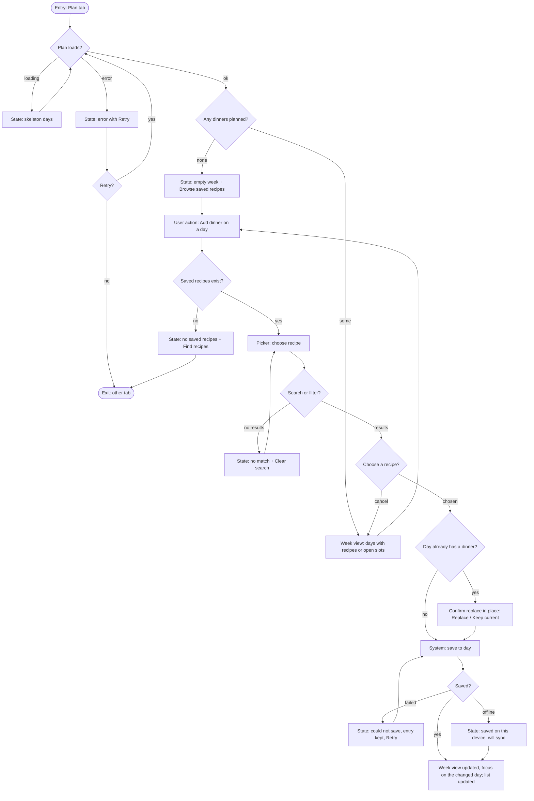
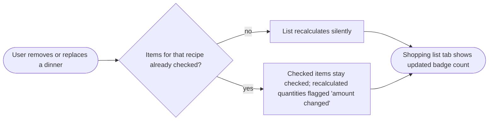

## Summary

Three task flows: plan a dinner for a day, use the shopping list, and change the plan after shopping has
started. Research is assumptions only, so flows rest on A-1..A-7 and are marked where an assumption
drives a branch. Every decision shows all outcomes; system interruptions (offline, load failure) and the
partial-data path (ingredients that cannot be summed) are drawn.

## Assumptions

- Research artifact is assumptions-only (no Findings); the user accepted that trade for this example.
- A-2: one recipe per day. A-6: some ingredient lines are free text. A-4: list may be opened offline.
- "Saved recipes" is an existing list; the planner links to it but does not change it.

Learnings applied: none

## Entry points

1. New tab "Plan" in the main navigation (primary).
2. "Add to plan" action on a saved recipe (secondary; lands in the picker's day step).
3. Shopping list tab from a "View shopping list" button on the planner (and directly via tab).

## Flow 1: put a dinner on a day (happy path and branches)

Permissions: none (single-user plan, no roles in v1; shared households are Assumption A-7, out of scope).
Keyboard path: tab to day button, Enter opens picker, arrow or tab through recipes, Enter selects, Escape cancels, focus returns to the day.

## Flow 2: use the shopping list

1. Entry: Shopping list tab, or "View shopping list" from the planner.
2. Decision: plan has dinners? No: empty state "Nothing to shop for" with "Plan dinners". Yes: continue.
3. Decision: list loads? Loading (skeleton) / error (retry, keeps last known list if cached) / ok.
4. Decision: all ingredients parsed? All: populated list grouped by store section. Some not: **partial** state, list shows summable items plus a notice "N ingredients couldn't be added" with those listed by recipe.
5. User checks items off. Check state persists on the device and survives reload.
6. System interruption: connection lost mid-use: checking continues locally, notice "Offline: changes will sync".
7. Exit: done shopping; "Clear checked items" (reversible with Undo, no confirm dialog).

## Flow 3: plan changes after shopping started (hypothesis H-4)

Open risk: if the recalculated amount goes down below what the user already bought, the list cannot know.
We show "amount changed" and keep the item; we do not remove checked items automatically.

## Check

No dead ends: every error state has Retry or an exit; every empty state has one action; Escape and Cancel
return to the week view. No orphan screens: picker is reachable only from the planner or a recipe.

## Open questions

- Q1 (research): do users want more than one recipe per day? Changes the slot model. Owner: research.
- Q2 (engineering): are ingredients stored structured (amount, unit, item)? Drives how common "partial" is.
- Q3 (product): week starts Monday or Sunday, and is it a locale setting? Assumed Monday for en.
