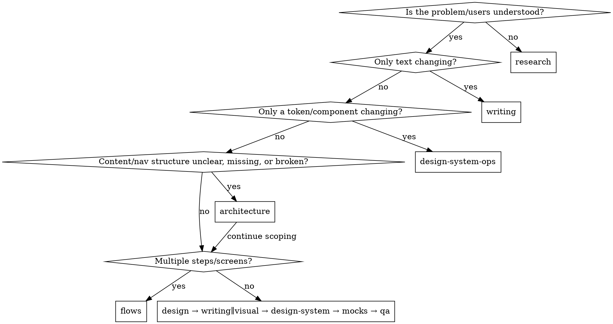

# Routing playbook

Map the request to the smallest pipeline that does the job. Bigger isn't better — only involve a
specialist that adds value. Always present the chosen pipeline to the user before running it.

Before routing, pull the requirement from the tracker named in `PROJECT.md` (`integrations.md`) so the
pipeline targets the real acceptance criteria — don't infer requirements you can read.

## Request type → pipeline

| The user wants… | Pipeline |
|------------------|----------|
| Understand a problem / users | `research` (→ `architecture`/`flows` if structure is implicated) |
| A whole new feature, end-to-end | `research → architecture → flows → design → (writing ∥ visual → design-system) → mocks → qa` |
| Design / redesign a screen | `design → (writing ∥ visual → design-system) → mocks → qa` (reuse existing research/architecture/flows) |
| Structure content, taxonomy, sitemap, or nav — no downstream flow impact | `architecture` (← research if it exists) |
| Structure content, taxonomy, sitemap, or nav — AND it changes how users move through the product | `architecture → flows` (← research if it exists) |
| Map a flow / journey | `flows` (← research/architecture if they exist) |
| Write or fix copy | `writing` (read the design for context) |
| Visual pass / restyle | `visual → design-system → mocks → qa` |
| Build mockups | `mocks` (requires design + content + visual + components to exist first; responsive optional) |
| Audit / QA existing work | `qa` |
| Add / change a token or component | `design-system-ops` (intake → review → build) then `design-system` to apply it |
| Design work on an empty project (`design_system.source: none`) | `design-system-ops` Mode 0 first (provisional system, owner, user agreement), then the pipeline above against it: `… design → (writing ∥ visual → design-system) → mocks → qa` |
| Make it work across devices/sizes | `responsive` (after `design`; often ∥ writing/visual) |
| Build a clickable / animated prototype | `prototyping` (after `design`; needs design + flows, mocks optional) |
| Hand an approved design to engineering | `handoff` (requires design, content, visual, components, mocks, and `qa` passed first) |
| Define or measure success | `metrics` (side loop; ties to requirement goals + the analytics source) |
| Start work on a new project | create `PROJECT.md` first, then route as above; if it has no design system, run the empty-project row before any visual work |
| "I'm not sure where to start" | `research` first; let findings shape the rest |

## Scoping — pick the unit of work

- **Single element / copy / token** → one specialist, no pipeline.
- **Single screen** → `design → writing ∥ visual → design-system → mocks → qa`.
- **Feature / flow** → start at `research` or `flows`.
- **System change** (new/changed component or token) → `design-system-ops`, then propagate.

## Parallelization rules

- `writing` and `visual` are independent once `design` exists → run them in parallel.
- `research`, `architecture`, `flows`, `design` are sequential (each needs the prior; skip a
  stage that isn't needed for this request, but never run the stages that *are* present out of
  order or in parallel with each other).
- `mocks` needs design + content + visual + components → it's a join point; don't start early.
- On an empty project the provisional system comes before `visual`, since visual binds to its tokens
  and `design-system` can't exist without visual. The lead blocks `visual` until it exists.
- Before routing a specialist, check its required inputs (`handoff-protocol.md`, "Missing inputs"):
  schedule the missing stage, or get the user's agreement to stated assumptions where the input is
  replaceable.
- `design-system-ops` runs as a side loop, not in the critical path — triggered by flagged gaps.
- If the runtime supports parallel subagents, use them for independent stages; otherwise run in
  sequence. Correctness never depends on parallelism.

## Decision flow (when unsure)



## The design-system growth hook

Whenever any specialist flags a gap (missing token/variant/component), the lead ensures it lands in
`<artifacts_dir>/design-system/SYSTEM-BACKLOG.md` and notifies `pd-design-system-ops`. When the gap isn't blocking, the product work continues with the closest existing part (noted as a
substitution) and the system catches up asynchronously; a blocking gap stops that element until
`pd-design-system-ops` resolves it. See `handoff-protocol.md` → "Design-system growth loop."

## Maintaining the index

`pd-design-lead` is the sole owner and writer of `<artifacts_dir>/INDEX.md` — specialists report
artifact creation back to the lead rather than editing it directly, to avoid conflicting writes on
a shared file.

1. **One row per artifact, added the moment it's created** (status `draft`), not after it's done.
2. **Status mirrors the artifact's own header** (`draft → in-review → approved → superseded`, per
   `handoff-protocol.md`). Update the row every time the header status
   changes — don't let the index and the artifact drift apart.
3. **Never delete a row.** When an artifact is superseded, add the replacement as a new row and set
   the old row's status to `superseded → see <new file>`, so history stays traceable from the index
   alone.
4. **Group by feature/epic** with a `Feature` column once more than one feature is in flight — a
   flat undifferentiated list stops being scannable past ~10 rows.
5. **Side-loop artifacts are indexed too** — `design-system/SYSTEM-BACKLOG.md` and `CHANGELOG.md`
   entries, and `*-metrics-*.md`, get rows exactly like pipeline artifacts. Running outside the
   critical path doesn't exempt them from being tracked.

```markdown
# Design index — <project>

| Date | Feature | Artifact | Discipline | Status | Owner |
|------|---------|----------|------------|--------|-------|
| 2026-03-02 | onboarding | 2026-03-02-research-onboarding.md | research | approved | pd-ux-research |
| 2026-03-03 | onboarding | 2026-03-03-architecture-onboarding.md | architecture | approved | pd-ux-architecture |
| 2026-03-04 | onboarding | 2026-03-04-flows-onboarding.md | flows | in-review | pd-ux-flows |
```
